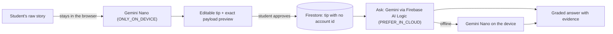

# Wish I’d Known

**The things nobody told you, written down by the students who found out the hard way.**
A student-built knowledge base for a fictional university (Halden). Every answer shows what the handbook says, what students report, and what nobody knows yet. Built for #BuildHybridAI 2026 with Firebase AI Logic.

- Live app: [https://wishidknown.web.app](https://wishidknown.web.app)
- Demo video: _add your YouTube link_

## The problem
Universities have an official rulebook and an unofficial one. Which hostel block is better, what the warden actually stops you for, what happens if you skip experiential learning, how to switch from hosteller to day scholar: none of it is written down, and even seniors disagree. Students who want to share what they learned have good reasons not to put their raw story, names and details into a shared system.

## How hybrid inference is the product
| Step | Mode | Why |
|---|---|---|
| Add a tip: read the raw story, extract one structured tip | `ONLY_ON_DEVICE` (Gemini Nano in Chrome) | The raw story must never leave the device, so there is deliberately no cloud fallback. If Nano is unavailable the student writes the tip by hand. |
| Ask: build an evidence-graded answer | `PREFER_IN_CLOUD` (Gemini, falls back to Nano offline) | Cross-tip reasoning is cloud work, but the same question still works offline. The answer says which model produced it. |

Fixed rules (not just the model) remove common identifiers before and after Nano: emails, phone numbers, Aadhaar-style numbers, roll numbers, room numbers, names after a title (Dr, Prof, Warden) and names after a role ("my roommate Aisha"). This is a safety net, not a guarantee: a bare name in an unusual sentence can slip through. That is why the student always edits and approves the tip and can open **Exactly what will leave this device** before sharing. Ask has the same transparency: **Exactly what was sent**.

## Answers are graded, not just generated
Each answer is split into: **From the handbook**, **Heard from several students** (needs 3 or more tips), **One person’s experience** (always labelled unverified), **Handbook vs. what students report**, and **Still unclear**. The model proposes claims with evidence ids; the app checks them. Claims without valid evidence are dropped, and a "repeated" claim backed by fewer than 3 tips is downgraded. If nothing matches, the app says nobody has written it down instead of guessing.

## Architecture


## Firebase products
Firebase AI Logic (hybrid inference), Firestore, Anonymous Authentication, App Check, Remote Config (answer model and "repeated" threshold, changeable without redeploying), Hosting.

## Privacy, stated precisely
- The raw story stays in the browser.
- Only the approved short tip is stored, with no name and no account id on it.
- Anonymous sign-in lets a student delete their own tips. A separate private record (`tipOwners`) links a tip to the anonymous account. The tip and its owner record are written in one atomic batch, and the rules refuse an owner record for a tip that already exists, so nobody can claim someone else's tip. Only the owning account can read or delete the record.
- Tips added through the app appear as **Community tip, unreviewed**. Handbook entries and tips marked **Sample** are invented for the demo and are never presented as real student counts.

## Testing it
- **Online:** Ask any question, e.g. "Are there rules about what I can wear in the hostel?". The footer says the cloud answered, and **Exactly what was sent** shows the prompt.
- **Offline:** turn Wi-Fi off, then ask. The footer says Gemini Nano answered on the device, using the tips already loaded.
- **No relevant evidence:** ask "Who is the vice chancellor?" The app says nobody has written it down.
- **Nano unavailable** (Firefox, Safari, phones, older Chrome): Ask still works through the cloud, and Add a tip lets you write the tip by hand. Nothing is cleaned in the cloud.
- `npm test` runs the scrubber, retrieval and grounding tests.

## Run it locally
Requires desktop Chrome 139+ for on-device AI (the model downloads on first use).
```
npm install
cp .env.example .env     # fill in your Firebase web config
npm run dev
npm test
```
Firebase setup: enable AI Logic (Gemini Developer API), Firestore, Anonymous sign-in, App Check, and publish `firestore.rules`. Add Remote Config parameters `ask_model` (string) and `repeat_min` (number).

## Built during the contest period
All code in this repository was written during the #BuildHybridAI 2026 contest period.

## License
Apache-2.0
