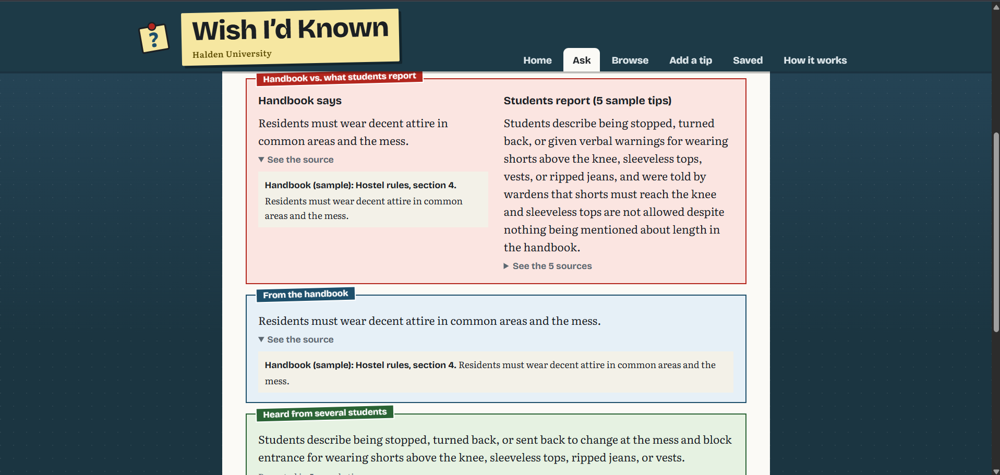
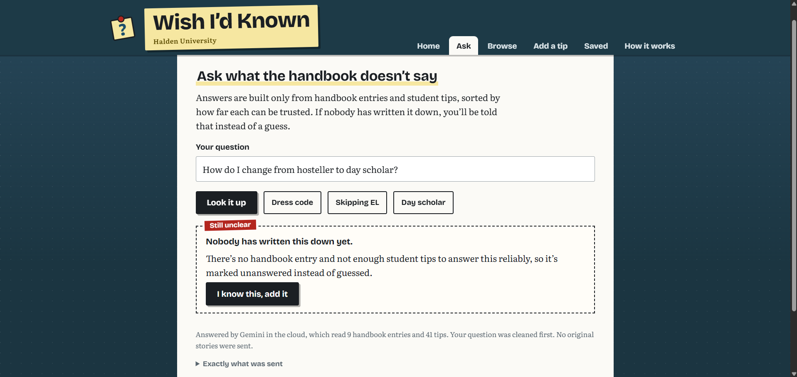
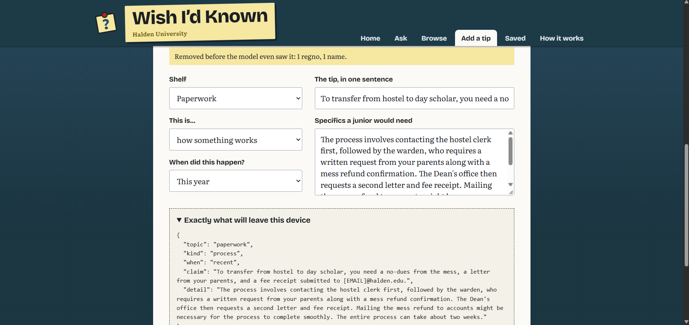
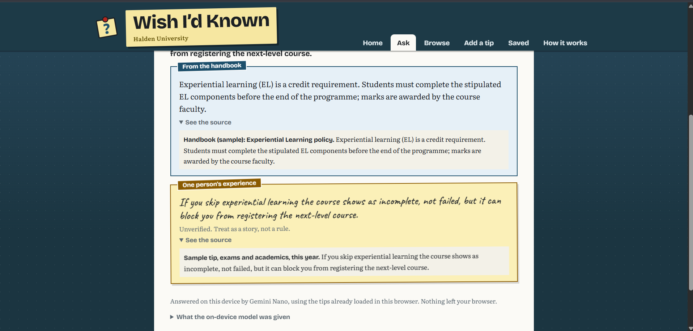
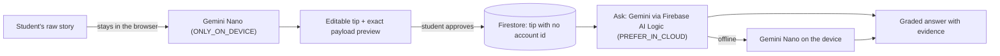

# Wish I'd Known

**Someone figured it out. Now you don't have to.**

A student-built guide to everything university doesn't put in the handbook.

Universities have an official rulebook. Students have the unofficial one: the hostel rules nobody explains, the processes you discover halfway through, and the little things you only learn by asking the right person.

Wish I'd Known brings both together. Ask questions, find what the handbook actually says, compare it with reported student experiences, and contribute the things you wish someone had told you earlier.

- **Live app:** https://wishidknown.web.app
- **Demo video:** https://youtu.be/TQ74_9WF4xk?si=bLTv_rTt6Kbx03RJ
- Built for #BuildHybridAI 2026 with Firebase AI Logic. 

About the demo data: Halden University is fictional. Handbook excerpts and tips marked **Sample** are invented for demonstration purposes. They are not real university policies or student research.

| Handbook vs. what students report | When nobody has written it down |
|---|---|
|  |  |
| **Exactly what leaves the device** | **Offline, answered by Gemini Nano** |
|  |  |

## The problem
Every university has two versions of itself.

There's the official version: handbooks, notices, portals and policies. Then there's the version students actually navigate.

Which hostel block is quieter? What does the warden actually enforce? What happens if you miss Experiential Learning? How do you switch from hosteller to day scholar? Which office handles a particular request?

These answers are scattered across conversations, passed down from one batch to another, or simply lost when someone graduates.

And "just ask a senior" isn't always helpful. You need to know which senior, whether their experience applies to you, and whether what they're telling you is an official rule or just how things happened once.

We built Wish I'd Known to make that knowledge easier to find, easier to evaluate, and safer to pass on.

## What it does
- **Ask.** Answers come only from handbook excerpts and student tips, sorted by how far each can be trusted: *From the handbook*, *Heard from several students* (three or more tips), *One person's experience* (always marked unverified), *Handbook vs. what students report*, and *Still unclear*. If nobody has written it down, it says so.
- **Add a tip.** Students can turn a personal experience into something useful for the next person.
They write a story, Gemini Nano extracts a short structured tip on their device, and they can edit it before sharing. The app shows the exact information that will leave the device, so the student stays in control.
**Pass on what you wish you'd known.**
- **Browse, Saved, delete.** Tips are colour-coded by topic, can be saved in the browser, and authors can delete their own tips. Tips submitted through the app are labelled Community tip, unreviewed. A contribution is not automatically treated as verified policy.

## How hybrid inference is the product
The two AI paths have different jobs. That distinction is intentional.
| Step | Mode | Why |
|---|---|---|
| Add a tip: read the raw story, extract one structured tip | `ONLY_ON_DEVICE` (Gemini Nano in Chrome) | The raw story must never leave the device, so there is deliberately no cloud fallback. If Nano is unavailable, the student writes the tip by hand. |
| Ask, online | `PREFER_IN_CLOUD` (Gemini, model name from Remote Config) | Cross-tip reasoning is cloud work. If the cloud can't be reached, the same call falls back to Nano. |
| Ask, offline | `ONLY_ON_DEVICE` | With no network the app goes straight to Nano, using the tips already loaded in the browser. |

Every answer states which model produced it, using the SDK's reported inference source, and **Exactly what was sent** shows the real prompt.



## Answers are graded, not just generated
A language model can produce a convincing answer even when the available information doesn't support it. We wanted to address that problem in the application itself, not just through a better prompt.
The model proposes claims with evidence ids. The app then checks the proposed answer against its supporting sources:
- A claim whose cited sources don't contain most of its wording is dropped.
- A summary that says more than the claims beneath it is dropped.
- "Heard from several students" needs three or more tips (a Remote Config parameter). A lone story stays labelled as one person's experience.
- If the model says the sources don't answer the question, the app shows "Nobody has written this down yet" instead of a guess.

## Privacy, stated precisely
- The raw story stays in the browser.
- Fixed rules remove common identifiers before and after Nano: personal emails (office addresses such as `fees.office@halden.edu` are kept on purpose, since the next student needs them), phone numbers, Aadhaar-style numbers, roll numbers, room numbers, names after a title (Dr, Prof, Warden) and names after a role ("my roommate Aisha").
- This is a safety net, not a guarantee: a bare name in an unusual sentence can slip through. That is why the student always edits and approves the tip and can open **Exactly what will leave this device**.
- A story with almost no content is refused, and any model output that doesn't match the student's own story is discarded.
- Only the approved tip is stored, with no name and no account id on it. Anonymous sign-in lets a student delete their own tips: a separate private record (`tipOwners`) links a tip to the anonymous account, written in the same atomic batch as the tip. The rules refuse an owner record for a tip that already exists, so nobody can claim someone else's tip.
- Tips added through the app appear as **Community tip, unreviewed**.

## Firebase products
Firebase AI Logic (hybrid inference), Firestore, Anonymous Authentication, App Check (reCAPTCHA Enterprise, enforced for AI Logic), Remote Config (`ask_model`, `repeat_min`), Hosting.

## Try it (2 minutes)
Desktop Chrome 139+ gives the full on-device experience. The on-device model downloads once (a few GB), and the Add a tip page has a download button with progress. Without Nano, Ask still works through the cloud and Add a tip lets you write the tip by hand.
1. Ask: "Are there rules about what I can wear in the hostel?"
2. Ask: "How do I change from hosteller to day scholar?"
3. Add a tip, use the sample story, clean it, and open "Exactly what will leave this device".
4. Ask the day scholar question again.
5. Turn Wi-Fi off and ask "What happens if I don't complete experiential learning?" The footer says Gemini Nano answered on the device.

`npm test` runs the scrubber, retrieval and grounding tests.

## Limits
On-device output is English only. Cleaning reduces identifying details but can't promise to catch every one. Community tips are unreviewed, and there is no report-and-hide control yet.

## Run it locally
```
npm install
cp .env.example .env     # fill in your Firebase web config
npm run dev
npm test
```
Firebase setup: enable AI Logic (Gemini Developer API), Firestore, Anonymous sign-in and App Check, and publish `firestore.rules`. Add Remote Config parameters `ask_model` (string) and `repeat_min` (number).

## Built during the contest period
All code in this repository was written during the #BuildHybridAI 2026 contest period.

## License
Apache-2.0